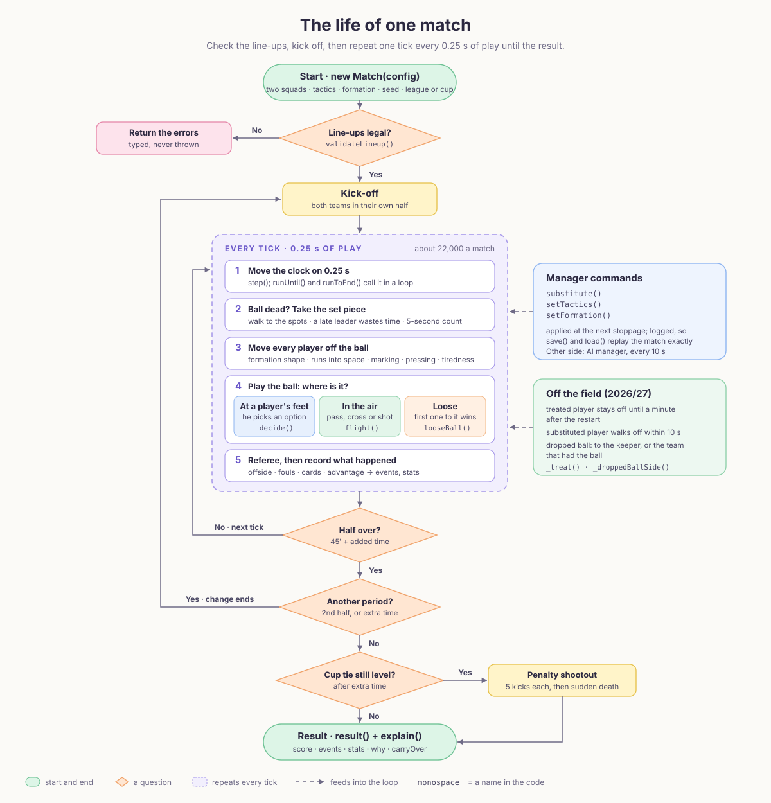

# Match Engine: scope and progress

> **In short:** a football match engine for a management game. It plays a full 90 minutes on a 2D pitch in 0.25-second steps, follows the Laws of the Game, and is tuned so its numbers match 8,907 real top-flight matches. A Next.js front end shows the match live, and there are tools and tests that check the engine.
>
> Version **0.5.0** · `main` · author Hyun · 9 November 2026

| | |
| :-- | :-- |
| 🧠 **Engine** | about 1,660 lines in one file, no dependencies, typed |
| 🖥️ **Front end** | 4 routes: matchday, tactics, report, lab |
| 🛠️ **Tools** | 7 Node command-line tools |
| ✅ **Tests** | 68 tests in 7 files, run on 3 operating systems × 2 Node versions |
| 📊 **Realism** | all 24 checks against real data pass |

---

## 1. The scope of the assignment

> ⚠️ **No brief file is in the repo.** I put the scope below together from the README's list of deliverables ("the engine, the library API, the visualizer, the calibration and balance tools, and this README") and from the CI file's comment about "every platform the brief requires". If you have the original brief, check this list against it.

What the engine has to do, as the project defines it:

| # | Deliverable | What "done" means | Status |
| :-: | :-- | :-- | :-: |
| 1 | 🧠 **Match engine** | Simulates a full match on its own. Same inputs, seed and commands give the same match every time. Never throws on bad input. | 🟢 Done |
| 2 | 📚 **Library API** | Usable from any game: `makeTeam`, `validateLineup`, `Match` (step, run, substitute, change tactics, save and load), `simulateMatch`, a full typed result | 🟢 Done |
| 3 | ⚽ **Laws of the game** | IFAB laws: restarts, offside, fouls, cards, advantage, substitutions, extra time, penalty shootouts, aggregate scores | 🟢 Done |
| 4 | 📈 **Realism** | Statistics match real league football: goals, shots, cards, corners, scorelines, half-time leads, how predictable results are against bookmaker odds | 🟢 24 of 24 pass |
| 5 | ⚖️ **Tactical balance** | Every tactic and formation changes how a team plays, and none wins outright. Every player attribute matters. | 🟢 Done |
| 6 | 🖥️ **Visualizer** | Live 2D match with touchline controls, a tactics board, a match report, and an Engine Lab | 🟢 Done |
| 7 | 🛠️ **Calibration and balance tools** | Command-line tools that measure all of the above | 🟢 Done |
| 8 | 🌍 **Cross-platform** | Runs on Windows, macOS and Linux with Node 20 and 22 | 🟢 CI matrix |
| 9 | 📖 **Documentation** | A README that explains the API, the calibration and the design | 🟢 Done |

**Not in scope** (left out on purpose): VAR, concussion substitutes, goal-line technology, and yellow cards adding up across a season. The engine reports each player's yellows in `carryOver` so the game can count them.

---

## 2. System design

How the parts fit together. The engine sits in the middle, and everything else uses it.


| Layer | Where | What it does |
| :-- | :-- | :-- |
| 🟪 **Engine** | `src/engine/engine.js` + `engine.d.ts` | The whole simulation: tick loop, player decisions (each option scored on one scale: chance of success × threat of the new position − cost of losing the ball), laws, and the tuning tables (`TUNING`, `TACTIC_EDGE`, `MATCHUPS`, `FORMATION_EDGE`). Uses one seeded random number generator. |
| 🟦 **Front end** | `src/app`, `src/components` | Next.js routes `/`, `/tactics`, `/report` and `/lab`. `AppProvider` keeps state when you move between pages. Batches of matches run in a pool of Web Workers so the page stays responsive. |
| 🟩 **Shared library** | `src/lib` | `metrics.js` computes the statistics the same way for real and simulated matches. `league.js` spreads squad quality like a real league. `predictability.js` fits results to the spread in bookmaker odds. |
| 🟧 **Tools** | `tools/*.mjs` | `simulate`, `calibrate`, `balance`, `attributes`, `fetch-data`, `build-reference`, and `fit-pass-odds` (fits pass odds to the engine's own physics). They run batches on worker threads. |
| 🟨 **Data** | `src/data/reference.json` | The real-football targets, built from football-data.co.uk (top five leagues, 2021/22 to 2025/26). The file is committed; the raw CSV files are not. |
| 🩷 **Quality** | `tests/`, `.github/workflows/ci.yml` | Vitest tests, plus CI that runs typecheck, tests, a headless match and the production build. |

---

## 3. How a match runs

From `new Match(config)` to the result object. The purple dashed line is the tick loop, which runs about 22,000 times in a 90-minute match.



1. **Check the lineup.** An illegal lineup returns typed errors and nothing is thrown.
2. **Kick off.** Every `step()` moves the clock forward 0.25 s.
3. **Each tick:** check whether the period is over, then whether the ball is dead (set piece), then move every player off the ball, then resolve the ball: a carrier decides, a ball in flight lands, or a loose ball is chased.
4. **Manager commands** (substitutions, tactics, formation) are logged and applied at the next stoppage. That log is what lets `save()` and `Match.load()` replay a match exactly.
5. **At the end of each period:** second half, extra time if a cup tie is level, then a shootout. Then `result()` and `explain()` give the score, the stats, `carryOver`, and a verdict with the factors that decided the match.

---

## 4. What's built so far

### 🗓️ Timeline

| Step | Milestone |
| :-: | :-- |
| 1 | 🌱 Prototype engine with a browser front end |
| 2 | ⚛️ Moved to Next.js with a typed engine module |
| 3 | 📊 Calibrated and tuned against real league data |
| 4 | 🧠 Finished the engine: laws, tactic balance, speed, match explanations (PR #1) |
| 5 | 🏆 Cup ties (extra time, shootouts), squad quality checked against odds, CI on 3 operating systems (PR #2) |
| 6 | 🎨 Visual polish: match officials, ball flight, the keeper's 8-second count (PR #3) |
| 7 | 🧪 Every player attribute matters, with a test for each (PR #4) |
| 8 | 📐 Scorelines and half-time leads checked against real data (PR #5) |
| 9 | 🏃 Attacking play reworked so the whole team builds and finishes moves; engine 0.5.0 (PR #6) |

### 📊 How close it is to real football (3,000 simulated matches)

| Metric | Engine | Real | |
| :-- | --: | --: | :-: |
| Goals per match | 2.79 | 2.81 | ✅ |
| Shots per match | 25.5 | 25.2 | ✅ |
| Shots on target | 34.5% | 34.9% | ✅ |
| Cards per match | 4.24 | 4.29 | ✅ |
| Home / draw / away | 44 / 27 / 29 | 44 / 25 / 31 | ✅ |
| Half-time leader wins | 74.9% | 73.1% | ✅ |
| Favourite wins (against odds) | 51.7% | 53.8% | ✅ |

### 🏃 Latest change: attacking play (PR #6, engine 0.5.0)

| Area | What changed |
| :-- | :-- |
| 🧠 Decisions | Shoot, carry, pass, cross and clear are weighed on one scale. Pass odds come from a logistic model fitted to the engine's own physics (`npm run fit-pass-odds`). |
| 🏃 Movement | Midfielders push between the lines, full-backs overlap, wingers come inside or attack the far post, and forwards run in behind or drop short. |
| 🛡️ Defending | Defenders mark by danger and step into passing lanes, and keepers sweep. Passes can be cut out anywhere along their path, and long balls bring aerial duels. |
| 🔧 Fixes | The offside line now includes the ball, strikers with their back to goal are marked from behind, stamina matters, and the shooting and keeping attributes change scoring odds instead of hitting a cap. |
| ⚠️ Saves | Saved matches record the engine version. A 0.4 save does not replay exactly on 0.5. |

---

## 5. What's left

- [ ] Check the scope in section 1 against the original brief
- [ ] Offsides and pass completion are only checked against rough estimates, because the dataset has no data for them
- [ ] Goal timing is checked by half only; the dataset has no goal minutes

---

## 6. Run it

```bash
npm install
npm run dev                 # http://localhost:3000
npm test                    # 68 tests
npm run simulate -- --seed 42
npm run calibrate -- 500    # compare with real football
npm run balance -- 200      # tactic and formation win rates
```

<sub>Diagrams: <code>docs/flowchart.svg</code> and <code>docs/system-design.svg</code>, both hand-written SVG. They open in any browser, and GitHub shows them inline.</sub>
