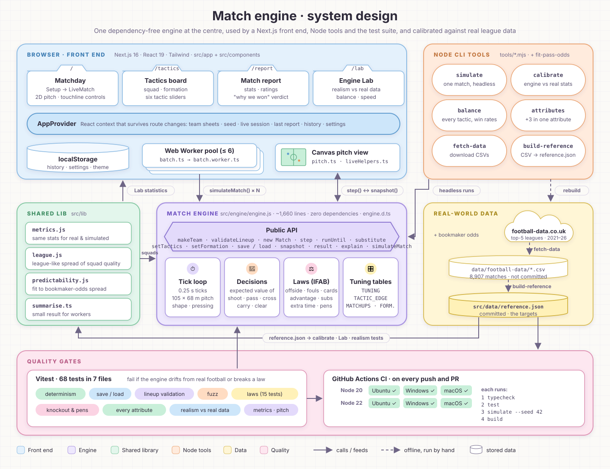

# Match Engine: scope and progress

> **In short:** a football match engine for a management game. It plays a full 11 v 11 match on a 2D pitch in 0.25-second steps, follows the IFAB Laws of the Game 2026/27, and is tuned so its numbers match 8,907 real top-flight matches. A Next.js visualizer plays the 96 real clubs of the five top European leagues live, with their real 2025/26 squads, and command-line tools and tests check the engine.
>
> Version **0.6.0** · `main` · author Hyun · 9 November 2026

| Part | At a glance |
| :-- | :-- |
| **Engine** | `src/engine/engine.js`, about 1,820 lines, no dependencies, typed by `engine.d.ts` |
| **Visualizer** | 4 routes: `/` matchday, `/tactics`, `/report`, `/lab` |
| **Real clubs** | 96 clubs and 1,920 real players (2025/26), national flags, kit colours, crests, editable ratings |
| **Tools** | 8 Node command-line tools in `tools/` |
| **Tests** | 97 tests in 8 files, 40 of them on the rules of football; CI is set up for 4 jobs on Linux, Windows and macOS, but the account has no Actions minutes, so every change is checked locally |
| **Realism** | 24 of 24 real-data checks pass, and 12 of 12 match-flow numbers sit in their published ranges |
| **Speed** | about 250 ms per match on one core; about 18 matches a second in the browser's worker pool |

---

## 1. The brief and where each part stands

The brief (version 1.0, November 2026) asks for four deliverables and scores them on five questions.

### The four deliverables

| # | Deliverable | Where it lives | Status |
| :-: | :-- | :-- | :-: |
| 1 | Engine that simulates a match between two squads | `src/engine/engine.js` | Done |
| 2 | Library API for a management game | `Match`, `simulateMatch`, `makeTeam`, `validateLineup` (typed in `engine.d.ts`) | Done |
| 3 | Visualizer that shows a match | `src/app`, `src/components`, canvas pitch in `src/lib/pitch.ts` | Done |
| 4 | A short README: build, run and use | `README.md` (cut to build, run and use in PR #7) | Done |

### The five scoring questions

| # | Question from the brief | How the project answers it | Proof |
| :-: | :-- | :-- | :-- |
| 1 | Does it follow the Laws of the Game 2026/27? | Restarts, offside, fouls, cards, advantage, the keeper's 8 seconds, 5-second countdowns, treatment, dropped balls, substitution windows, extra time, shootouts | 40 rule tests: 32 in `tests/laws.test.ts` (8 on offside), plus lineup, substitution and cup-tie rules in `engine.test.ts` and `knockout.test.ts` |
| 2 | Do its statistics match real football (distributions, not just averages)? | `npm run calibrate` compares full distributions with 8,907 real matches | 24 of 24 pass, plus 12 of 12 match-flow ranges |
| 3 | Can it be plugged into a game? | Run to a minute or event, pause, resume, substitute, change tactics, save and load, headless batches, `carryOver` | `tests/engine.test.ts` (determinism, save and load, fuzz) |
| 4 | Does it look like football? | Live 2D pitch with officials, ball flight, players walking off, countdown rings; real clubs and players, crests, and kits that never clash | The visualizer at `/` |
| 5 | Do decisions, attributes and tactics matter? | Every tactic and formation has a cost and a benefit (`TACTIC_EDGE`, `FORMATION_EDGE`, `MATCHUPS`); every attribute moves results | `npm run balance`, `npm run attributes`, `tests/attributes.test.ts` |

### What the game needs from the engine

| When | The brief asks for | The engine's answer |
| :-- | :-- | :-- |
| Before | Two squads, formation, tactics, seed; refuse illegal lineups | `makeTeam(...)`, `validateLineup(team)` returns typed errors, never throws |
| During | Run to a minute or the next key event, pause and resume | `m.runUntil({ minute })`, `{ event: 'goal' }`, `{ event: 'key' }`, `{ ticks }` |
| During | Substitute and change tactics or formation | `m.substitute()`, `m.setTactics()`, `m.setFormation()`, applied at the next stoppage |
| During | Any speed: live, fast-forward, skip | `m.step()` from a timer, `m.snapshot()` to draw, `m.runToEnd()` to skip |
| After | Result, event log, team and player stats | `result()`: `score`, `events`, `teamStats`, `playerStats` |
| After | Fatigue, minutes, injuries, cards, suspensions | `carryOver` |
| After | Explain why a team won or lost | `explain()`: a verdict and ranked factors |
| Season | Thousands of background matches, quickly | `simulateMatch()`; Web Worker pool in `src/lib/batch.ts` |
| Season | Exact replay; saving and loading must not change results | One seeded random number generator; `m.save()` and `Match.load(saved)` |
| Season | Many leagues and clubs, changing squads | No global state: every match takes its squads as input |
| Season | Never crash or hang | Fuzz test, typed errors, and a hard tick cap |

**Left out on purpose:** VAR, concussion substitutes, goal-line technology, and yellow cards adding up across a season. The engine reports every player's cards in `carryOver` so the game can count them.

---

## 2. System design

The engine sits in the middle. The visualizer, the tools and the tests all call it, and real league data sets its targets.



| Layer | Where | What it does |
| :-- | :-- | :-- |
| **Engine** | `src/engine/engine.js` + `engine.d.ts` | The whole simulation: the tick loop, player decisions, the laws and the tuning tables. Uses one seeded random number generator. |
| **Visualizer** | `src/app`, `src/components` | Next.js routes `/`, `/tactics`, `/report` and `/lab`. `AppProvider` keeps state between pages. Batches run in a pool of up to 6 Web Workers. |
| **Shared library** | `src/lib` | `metrics.js` computes stats the same way for real and simulated matches. `league.js` spreads squad quality like a real league. `predictability.js` fits results to bookmaker odds. `util.ts` turns `teams.json` into team sheets (`realTeam`), picks real clubs' XIs (`pickXI`), applies rating edits (`setAttr`) and settles kits at kick-off (`matchKits`). |
| **Tools** | `tools/*.mjs` | `simulate`, `calibrate`, `balance`, `attributes`, `fetch-data`, `build-reference`, `build-teams`, `fit-pass-odds`. Batches run on worker threads. |
| **Data** | `src/data/reference.json`, `src/data/teams.json` | Real-football targets from football-data.co.uk (top five leagues, 2021/22 to 2025/26), and the real clubs and squads from the CC0 transfermarkt-datasets with derived ratings. Both files are committed; the raw downloads are not. Crests are loaded from transfermarkt at runtime, not stored. |
| **Quality** | `tests/`, `.github/workflows/ci.yml` | Vitest tests, and CI that runs typecheck, tests, one headless match and the production build. |

---

## 3. How a match runs

From `new Match(config)` to the result. The purple dashed line is the tick loop, which runs about 22,000 times in a 90-minute match.


1. **Check the lineup.** `validateLineup()` returns typed errors for an illegal lineup. Nothing is thrown.
2. **Kick off.** Each `step()` moves the clock 0.25 s. `runUntil()` and `runToEnd()` call `step()` in a loop.
3. **Each tick:** is the period over? Is the ball dead (set piece)? Then `_targets()` and `_move()` move every player off the ball, and the ball is resolved:
   - at a player's feet: `_decide()` picks shoot, pass, cross, carry or clear; `_tackles()` handles challenges, fouls and cards
   - in the air: `_flight()` handles passes, crosses, shots and offside
   - loose: `_looseBall()` and `_checkOut()` handle chases, throw-ins, corners and goal kicks
4. **Set pieces.** Players walk to their spots. A side leading after 75 minutes may waste time, and the referee can start a 5-second countdown (`_delayedRestart()`). The restart happens in `_resume()`.
5. **Off the field.** A treated player stays off until one minute after the restart (`_treat()`). A substituted player walks off within 10 seconds. A dropped ball goes to the keeper in his area, or else to the team that had it (`_droppedBallSide()`).
6. **Manager commands** are logged and applied at the next stoppage. That log is what lets `save()` and `Match.load()` replay a match exactly.
7. **End of each period** (`_endHalf()`): second half, then extra time in a level cup tie, then a shootout. `result()` and `explain()` give the score, the stats, `carryOver` and the verdict.

### How a player decides (`_decide()`)

Each option gets one value: **chance it works × value of the new position − chance of losing the ball × what that gives the opponent.** The settings for this live in `TUNING` (`threat`, `room`, `lossWeight`, `shotAppetite`, `shotBias`). Pass odds come from `PASS_ODDS`, a logistic model fitted to the engine's own physics with `npm run fit-pass-odds`.

---

## 4. Names to know

| Name | What it is |
| :-- | :-- |
| `TUNING` | Every tuned number: finishing, fouls, cards, ball friction, time-wasting and more |
| `TACTIC_EDGE` | How each tactic setting changes the chances a side creates and concedes |
| `FORMATION_EDGE` | The same for each formation: `[created, conceded]` |
| `MATCHUPS` | Rock-paper-scissors between styles, for example direct balls against a high line |
| `PASS_ODDS` | The fitted pass-completion model |
| `ENGINE_VERSION` | Saved matches record it; a save only replays exactly on the same version |
| `carryOver` | What the game keeps after a match: minutes, condition, injuries, cards, suspensions |
| `QUICK_TESTS` | Set to `1` to skip the 18 statistical tests (79 tests run in about 9 s) |
| `teams.json` | The 96 real clubs: strength, kit colours, crest id and 20 players each, ratings derived by `build-teams` |
| `pickXI`, `matchKits` | The app's XI pick for real clubs (natural full-backs and wingers out wide) and its kit-clash rule |
| `describeStatistical`, `itStatistical` | Test helpers in `tests/statistical.ts` that `QUICK_TESTS` skips |
| `breathe()` | Test helper in `tests/breathe.ts` that lets long test loops yield between matches |

---

## 5. What's built so far

### Timeline

| Step | Milestone |
| :-: | :-- |
| 1 | Prototype engine with a browser front end |
| 2 | Moved to Next.js with a typed engine module |
| 3 | Calibrated and tuned against real league data |
| 4 | Finished the engine: laws, tactic balance, speed, match explanations (PR #1) |
| 5 | Cup ties (extra time, shootouts), squad quality checked against odds, CI on 3 operating systems (PR #2) |
| 6 | Visual polish: officials, ball flight, the keeper's 8-second count (PR #3) |
| 7 | Every player attribute matters, with a test for each (PR #4) |
| 8 | Scorelines and half-time leads checked against real data (PR #5) |
| 9 | Attacking play reworked so the whole team builds and finishes moves; engine 0.5.0 (PR #6) |
| 10 | Laws 2026/27: advantage and cards, treatment, walk-offs, countdowns, delay cautions, dropped balls; engine 0.5.1 (PR #7) |
| 11 | Match flow like real football: more out of play, fewer long shots, crossed free kicks, aerial duels; engine 0.6.0 (PR #8) |
| 12 | Engine twice as fast again (about 550 to about 280 ms a match), with identical results (PR #9) |
| 13 | README speed figures corrected (PR #10) |
| 14 | CI cut from 6 jobs to 4, with quick tests on Windows and macOS (PR #11) |
| 15 | Overview and diagrams brought up to engine 0.6.0 (PR #12) |
| 16 | Offside tests: 8 cases for Law 11, so every major law has a direct test (PR #13) |
| 17 | Final review: saves record the engine version, steadier Engine Lab checks (PR #14) |
| 18 | Real clubs and squads: league and club picker, 2025/26 players, national flags, kit colours, a player editor (PR #16) |
| 19 | Club crests, no kit clashes, README and 8 tests for the real squads (PR #17) |
| 20 | Natural full-backs and wingers in real clubs' XIs, a new seed after every match, this overview updated (PR #18) |

### How close it is to real football (3,000 simulated matches)

| Metric | Engine | Real | Result |
| :-- | --: | --: | :-: |
| Goals per match | 2.88 | 2.81 | pass |
| Shots per match | 25.2 | 25.2 | pass |
| Shots on target | 35.0% | 34.9% | pass |
| Corners per match | 9.6 | 9.7 | pass |
| Fouls per match | 24.0 | 23.8 | pass |
| Cards per match | 4.33 | 4.29 | pass |
| Home / draw / away | 43 / 26 / 30 | 44 / 25 / 31 | pass |
| Goals in the second half | 54.2% | 55.3% | pass |
| Half-time leader wins | 73.5% | 73.1% | pass |
| Favourite wins (against odds) | 52.2% | 53.8% | pass |

### Real squads

Nobody publishes 1–20 ratings, so `npm run build-teams` derives them: each club's strength from its real results, put on the spread the engine is calibrated on (centred on 12, standard deviation about 0.6); each player's level from his market value against his own position group, corrected for age; his profile from his exact position, height and age. Checked over 1,000 league matches:

| Metric | Real squads | Generated squads | Real football |
| :-- | --: | --: | --: |
| Goals per match | 2.73 | 2.63 | ~2.8 |
| Shots per match | 23.4 | 23.6 | ~25 |
| Stronger side wins | 56% | 52% | – |

### Match flow (published averages; not in the dataset)

| Metric | Before PR #8 | Now | Real football |
| :-- | --: | --: | --: |
| Throw-ins per match | 26.6 | 40.1 | ~41 |
| Goal kicks per match | 10.5 | 14.1 | ~16 |
| Ball in play | 65 min | 60 min | ~57 min |
| Shots from outside the box | 45% | 36% | ~36% |
| Passes per team | 556 | 471 | ~470 |
| Pass completion | 79.9% | 81.0% | ~82% |

### Speed

| Where | Time |
| :-- | --: |
| `simulateMatch` in Node, one core | about 235 ms per match |
| One browser thread (Engine Lab) | about 275 ms per match |
| Web Worker pool | about 18 matches a second, so a 380-match season takes about 21 s |

### CI (since PR #11)

| Job | Tests |
| :-- | :-- |
| Ubuntu, Node 20 | all 97 |
| Ubuntu, Node 22 | all 97 |
| Windows, Node 20 | 79 quick tests (`QUICK_TESTS=1`) |
| macOS, Node 22 | 79 quick tests (`QUICK_TESTS=1`) |

Each job runs typecheck, tests, `simulate --seed 42` and the build. CI runs on pull requests and pushes to `main`, skips changes that only touch `.md` files, and a new push cancels the old run. Since PR #14 the account has no Actions minutes, so the jobs stop before they start; every change since has been checked locally (typecheck, all tests, the build, and the calibration when the engine changed).

---

## 6. What's left

- [ ] The leading shooter takes 39% of his team's shots (real: about 32%). Hat-tricks and goal kicks are also near the edges of their ranges.
- [ ] Offsides and pass completion are only checked against rough estimates, because the dataset has none.
- [ ] Goal timing is checked by half only; the dataset has no goal minutes.
- [ ] Speed: the engine is about twice as slow as at PR #5, because of the richer off-ball positioning (`_findSpace`). Re-planning less often would fix it but changes results, so it needs a re-calibration.
- [ ] Saves record `ENGINE_VERSION`; a match saved on 0.5.x does not replay exactly on 0.6.0.
- [ ] Real players' ratings are derived, not published, and each league is rated on its own scale: the best clubs of every league are about equally strong. Squad numbers are assigned, and the squads are those of July 2026.
- [ ] Some real clubs' data lists their wide players as central, so their XIs still put central players out wide (216 of 576 wide slots across the 96 clubs in 4-3-3).

---

## 7. Run it

```bash
npm install
npm run dev                 # http://localhost:3000
npm test                    # 97 tests
QUICK_TESTS=1 npm test      # 79 quick tests
npm run simulate -- --seed 42
npm run calibrate -- 3000   # compare with real football
npm run balance -- 200      # tactic and formation win rates
npm run attributes -- 300   # what each attribute changes
npm run build-teams         # rebuild the real squads (after npm run fetch-data)
```

<sub>Diagrams: <code>docs/flowchart.svg</code> and <code>docs/system-design.svg</code>, both hand-written SVG. They open in any browser, and GitHub shows them inline.</sub>
